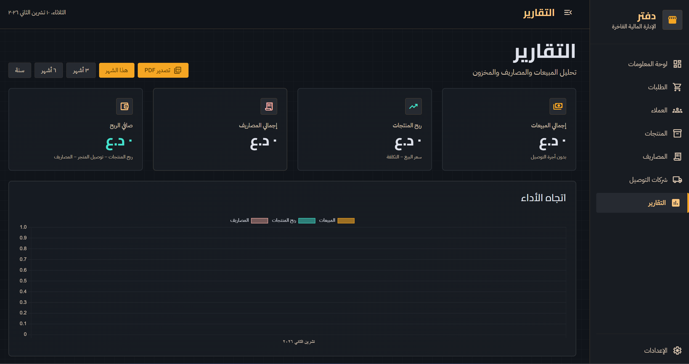
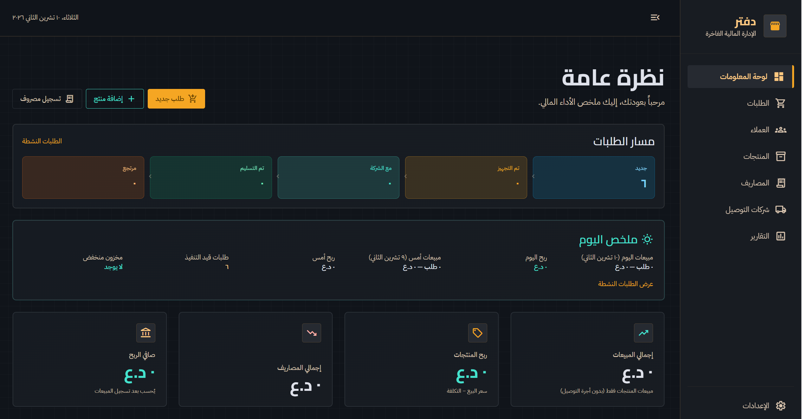

# دفتر (Daftar)

**دفتر** is an offline desktop app for Arabic social-commerce sellers — track orders, inventory, delivery, and real profit without a spreadsheet.

Built for Instagram, Facebook, WhatsApp, and TikTok sellers who need clear numbers and a fast daily workflow.

  

<em>لوحة المعلومات — نظرة عامة على المبيعات، مسار الطلبات، وملخص اليوم</em>

---

## Download

| Version | Platform | Installer |
|--------:|----------|-----------|
| **1.1.0** | Windows (x64) | [daftar-1.1.0-setup.exe](https://github.com/MohOneX/Dashboard-Releases/releases/download/v1.1.0/daftar-1.1.0-setup.exe) |

> Prefer the latest build? Open **[Releases](https://github.com/MohOneX/Dashboard-Releases/releases/latest)**.

After install, the app can check this repository for updates automatically.

---

## Why Daftar?

- **Offline-first** — your data stays on your PC (SQLite), no cloud login required for day-to-day work
- **Arabic RTL UI** — designed for Arabic sellers from the ground up
- **True profit** — product margin minus shop delivery costs and expenses
- **COD & delivery** — settle cash sitting with courier companies
- **Social commerce** — order source (Instagram / Facebook / WhatsApp / TikTok) and seller expense categories

  

<em>التقارير — المبيعات، ربح المنتجات، المصاريف، وصافي الربح مع تصدير PDF</em>

---

## Features

### Operations
- Multi-item orders with invoices and status flow (new → preparing → with courier → delivered)
- Customers CRM with spend history
- Products with size/color variants and stock tracking
- Delivery companies + WhatsApp messages to courier **and** customer

### Finance
- Dashboard KPIs: sales, product profit, expenses, net profit
- COD pending cash by courier company
- Expense categories for ads, packaging, inventory restock, salaries, utilities, and more
- Reports with period filters and PDF export

### Inventory
- Low-stock alerts that respect **variants** (e.g. size L at zero)
- Dead-stock list for products with no sales for 30+ days

---

## System requirements

- **Windows 10 / 11** (64-bit)
- About **200 MB** free disk space after install
- No internet required for core use (internet only for WhatsApp links and optional updates)

---

## Install

1. Download `daftar-1.1.0-setup.exe` from the [latest release](https://github.com/MohOneX/Dashboard-Releases/releases/latest)
2. Run the installer and follow the prompts
3. Launch **دفتر** from the Start menu or desktop shortcut

If Windows SmartScreen appears, choose **More info** → **Run anyway** (the app is not code-signed yet).

---

## Privacy

- Business data (products, orders, customers, expenses) is stored **locally** on your computer
- This repository hosts **release installers only** — application source code is maintained separately and is not public here

---

## Support

- Issues related to downloads or installers: open a ticket in this repo’s [Issues](https://github.com/MohOneX/Dashboard-Releases/issues)
- For feature requests about the product itself, contact the maintainer via the private project channel

---

## License & ownership

© Daftar. All rights reserved. Installers published here are for authorized distribution of the Daftar desktop application.

---

  <strong>دفتر</strong> — الإدارة المالية الفاخرة لبائعي التواصل الاجتماعي

